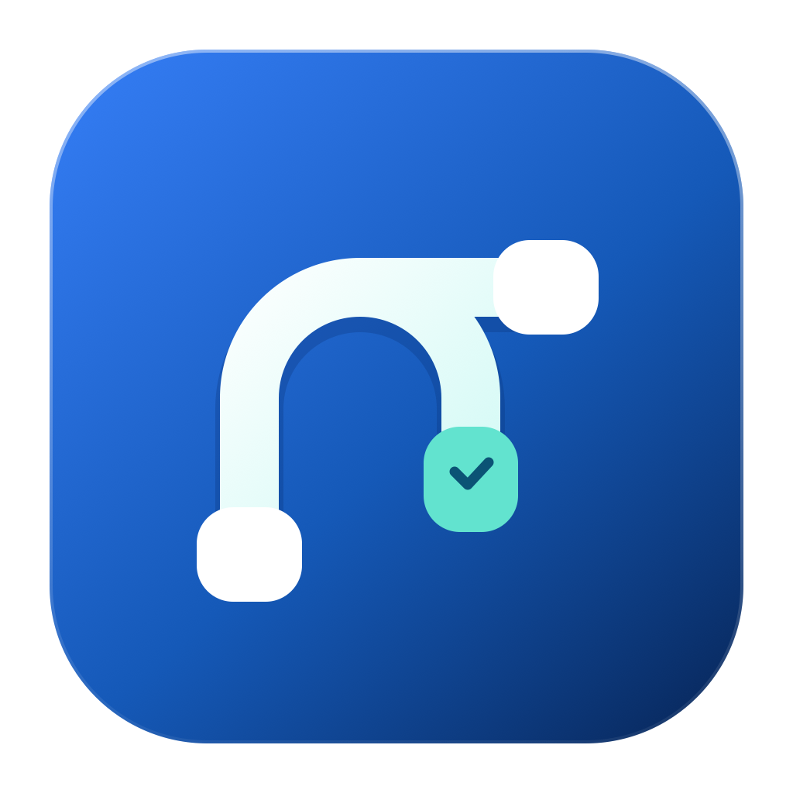

<div align="center">
  
  <h1>FlowgoSwift: Native Flowgorithm-Compatible App for Mac</h1>
  <p><strong>Flowchart programming for students on macOS and Apple Silicon.</strong></p>
  <p>Open and run Flowgorithm .fprg files on your Mac, without Wine, Rosetta, or Windows.</p>
  <p>Compatible with and heavily inspired by <a href="http://www.flowgorithm.org/">Flowgorithm</a>, created by <a href="http://devincook.com/">Devin Cook</a>.</p>
  <p>Thank you, Devin, for creating Flowgorithm and making visual programming approachable.</p>
  <p>
    
    
    
    
    <a href="LICENSE"></a>
  </p>
  <p>
    <a href="https://github.com/JohnSk4ll/FlowgoSwift/releases">Releases</a> ·
    <a href="#getting-started">Getting started</a> ·
    <a href="#build-from-source">Build from source</a> ·
    <a href="https://github.com/JohnSk4ll/FlowgoSwift/issues">Report an issue</a>
  </p>
</div>

Looking for **Flowgorithm for Mac** or a **native Flowgorithm-compatible app for Apple Silicon**? FlowgoSwift is a free, open-source macOS app for students learning algorithms and flowchart programming. Open, edit, and run Flowgorithm `.fprg` files on an Apple Silicon MacBook Air, MacBook Pro, iMac, Mac mini, or Mac Studio. Built in Swift and SwiftUI, it runs natively on ARM64 without Wine, Rosetta, a Windows virtual machine, or a Windows runtime.

FlowgoSwift interoperates with the Flowgorithm file format and is not affiliated with or endorsed by Flowgorithm or its creator, Devin Cook.

## Using Flowgorithm workflows for class on Apple Silicon Macs

FlowgoSwift is compatible with and heavily inspired by Flowgorithm. Its editing and execution workflow is deliberately similar to provide continuity between the Windows application your teacher and classmates use and FlowgoSwift on your Apple Silicon Mac. You can follow classroom demonstrations, recognize familiar flowchart concepts and controls, and work on the same kinds of algorithms without having to learn a different workflow just because you use macOS.

If your programming course shares Flowgorithm `.fprg` files, open them in FlowgoSwift to follow branches and loops, step through an algorithm, inspect variables, and see how a flowchart translates into Python, Java, or C++.

FlowgoSwift supports opening and saving `.fprg` files. Compatibility with every Flowgorithm feature is still being validated, so check your instructor's requirements before using it for assessed work and keep a copy of the original workflow.

## What you can do

| Capability | In FlowgoSwift |
| :--- | :--- |
| **Visual editing** | Build flowcharts with declarations, assignments, input/output, branches, loops, and functions. |
| **Workflow files** | Open and save `.fprg` files; import functions from another workflow. |
| **Run and debug** | Run, pause, step, and stop execution. Inspect the console, variable watch, and active statement. |
| **Source code** | View and export Python, Java, and C++; load `.fpgt` source templates. |
| **Turtle graphics** | Run drawing workflows and export turtle output as SVG. |
| **Share a chart** | Export the current flowchart as PDF or PNG. |
| **Mac integration** | Native document windows, undo/redo, and light and dark appearances. |
| **Command line** | Run and validate workflows or generate source using the included `flow` executable. |

## Getting started

**Current version: v1.0.0.** Requires an Apple Silicon Mac running macOS 13 Ventura or later. Intel/x86-64 Macs are not supported by this build.

1. Obtain `FlowgoSwift-v1.0.0-arm64.dmg` from a published [GitHub release](https://github.com/JohnSk4ll/FlowgoSwift/releases), or build the package locally using the instructions below.
2. Open the disk image and drag **FlowgoSwift** into **Applications**.
3. Launch the app, then use **File → Open** to open an existing `.fprg` workflow or **File → New** to create one.
4. Click a connector to insert a statement, double-click a shape to edit it, and use **Run** or **Step** to explore its behavior.

The current build scripts apply an ad hoc signature. The generated app is not Developer ID signed or notarized, so macOS may require explicit approval before opening a downloaded copy. A locally built package is not automatically published to GitHub Releases.

### If macOS blocks the first launch: Open Anyway

If macOS says it cannot verify the developer or check FlowgoSwift for malicious software, you can approve this app individually. Only approve a copy you downloaded from this repository's [Releases](https://github.com/JohnSk4ll/FlowgoSwift/releases) or built yourself and trust.

1. Try opening **FlowgoSwift** from **Applications** once so macOS records the blocked launch.
2. Dismiss the warning with **Done**, **OK**, or **Cancel**, depending on your macOS version.
3. Open **Apple menu → System Settings → Privacy & Security**, then scroll to **Security**.
4. Find the message about FlowgoSwift and click **Open Anyway**. On some macOS versions, click **Open** first to reach that option.
5. Authenticate if prompted, then confirm **Open** in the next dialog.

macOS saves an exception for FlowgoSwift, so subsequent launches normally work by double-clicking the app. If **Open Anyway** is missing, try opening the app again and return to these settings; the option is available for about an hour after a blocked launch. On a school-managed Mac, these controls may be restricted by your IT administrator.

See Apple's [guide to opening apps blocked by Gatekeeper](https://support.apple.com/en-gb/102445) and [Open Anyway instructions](https://support.apple.com/en-gb/guide/mac-help/mh40617/mac).

## Compatibility

FlowgoSwift supports a substantial set of Flowgorithm workflow features, including arrays, functions, console and file I/O, and turtle graphics. Compatibility with all Flowgorithm 4.5 workflows is still being validated. Some features, source-template directives, numeric edge cases, and platform-specific behavior can differ.

Keep a copy of an existing workflow before editing it. If a file behaves unexpectedly, [open an issue](https://github.com/JohnSk4ll/FlowgoSwift/issues) with a minimal `.fprg` example, the expected behavior, and your macOS version. Remove personal information from files before sharing them.

## Build from source

Install Xcode or the Command Line Tools with Swift 5.9 or later, then:

```sh
git clone https://github.com/JohnSk4ll/FlowgoSwift.git
cd FlowgoSwift
./scripts/build-app.sh
open "dist/FlowgoSwift.app"
```

The application uses system frameworks without external Swift package dependencies. The vector icon source is [`Resources/AppIcon.svg`](Resources/AppIcon.svg); the app builder regenerates its PNG and ICNS assets automatically.

To build the styled drag-to-Applications installer:

```sh
./scripts/build-dmg.sh
```

The package and its SHA-256 checksum are written to:

```text
build/FlowgoSwift-v1.0.0-arm64.dmg
build/FlowgoSwift-v1.0.0-arm64.dmg.sha256
```

DMG packaging additionally uses Python 3 and pinned `ds-store` and `mac-alias` packages, installed into an isolated environment under `build/dmg-tools` on first use. The build reads the release version directly from `Info.plist`.

The command-line tool is built alongside the app:

```sh
./dist/flow workflow.fprg --validate
./dist/flow workflow.fprg
./dist/flow workflow.fprg --source python > workflow.py
```

## Flowgorithm on Mac: frequently asked questions

### Can I open Flowgorithm files on a Mac?

Yes. FlowgoSwift opens Flowgorithm `.fprg` workflow files on macOS and lets you edit and execute supported flowchart statements. It is an independent compatible application; full compatibility with Flowgorithm 4.5 is still being validated.

### Does FlowgoSwift run natively on Apple Silicon?

Yes. The macOS app is compiled for ARM64 and runs natively on Apple Silicon, including M1, M2, M3, and M4 Macs. It requires macOS 13 Ventura or later. The current release supports Apple Silicon Macs only and does not support Intel/x86-64 Macs.

### Do I need Wine, Rosetta, Parallels, or Windows?

No. FlowgoSwift runs directly on macOS using Swift and SwiftUI. No Windows installation, compatibility layer, or virtual machine is required.

### Is FlowgoSwift the official Flowgorithm app?

No. FlowgoSwift is an independent, open-source app that works with Flowgorithm workflows. [Flowgorithm](http://www.flowgorithm.org/) was created by [Devin Cook](http://devincook.com/), and FlowgoSwift is not affiliated with or endorsed by him.

### Can I use it for a programming class?

Yes. The familiar workflow is intended to help you follow a teacher or classmates using Flowgorithm on Windows while you use FlowgoSwift on your Apple Silicon Mac. You can study compatible `.fprg` workflows, practice algorithms, and inspect execution. If your course requires the official Flowgorithm application or specific behavior, check with your instructor before using FlowgoSwift for assessed work.

## Credits and acknowledgments

- **Devin Cook**, creator of Flowgorithm and its workflow ecosystem. Official website: [https://www.flowgorithm.org/](https://www.flowgorithm.org/). Author information: [https://flowgorithm.org/about/info.html](https://flowgorithm.org/about/info.html). Documentation: [https://flowgorithm.org/documentation/index.html](https://flowgorithm.org/documentation/index.html).
- **JohnSk4ll**, maintainer of FlowgoSwift: [https://github.com/JohnSk4ll](https://github.com/JohnSk4ll). Project: [https://github.com/JohnSk4ll/FlowgoSwift](https://github.com/JohnSk4ll/FlowgoSwift).

## License

FlowgoSwift is distributed under the [MIT License](LICENSE).
